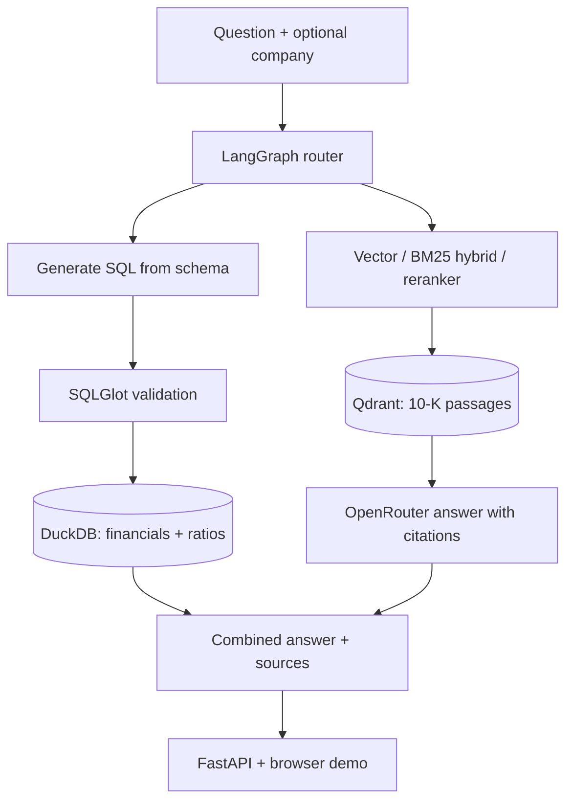

# Fin Agent — SEC Text-to-SQL + RAG

[](https://github.com/Saadmesbah/fin-agent/actions/workflows/ci.yml)

A finance question-answering project by Saad Mesbah, Data Science & AI engineering
student at ESI Rabat. Ask about annual financial numbers or company disclosures.
LangGraph routes to validated DuckDB SQL, cited document retrieval, or both.

## What works

- SEC Company Facts → DuckDB: **11 companies, 81 company/year rows**, FY2019 onward.
- AAPL, MSFT, JNJ 10-Ks → text → **882 passages**, BGE embeddings, Qdrant local storage.
- Vector search, BM25/vector reciprocal-rank fusion, and a cross-encoder reranker.
- OpenRouter answers with passage citations; invalid or missing labels are rejected.
- SQL generated from [schema.md](schema.md), checked using SQLGlot, executed read-only.
- FastAPI, a browser demo, Docker Compose, pytest, and GitHub Actions.

## Architecture



## Measured results

Measured on the saved project snapshot, November 17, 2026. The benchmark is small
and was used during development; these are **development results**, not held-out
or general finance accuracy. See the [full report](reports/REPORT.md) and JSON logs.

| Retrieval, company supplied (13 questions) | Hit@1 | Hit@3 | Hit@5 |
|---|---:|---:|---:|
| BGE vectors | 11/13 (84.6%) | 13/13 | 13/13 |
| BM25 + vectors, RRF | 12/13 (92.3%) | 12/13 | 13/13 |
| Hybrid + cross-encoder | 13/13 (100%) | 13/13 | 13/13 |

These scores check case/whitespace-normalized evidence phrases in passages.
They do **not** measure generated-answer correctness. The revised benchmark
accepts an evidence alternative for “AI”; it is distinct from the original run.

| Other checks | Result |
|---|---|
| Offline regression suite | 50/50 on Windows and Linux Docker |
| Docker build / health / snapshot SQL | Passed / healthy / 20/20 |
| Reference SQL vs saved numeric snapshot | 20/20 consistent (no LLM) |
| Live SQL, initial prompt | 9/20 exact result matches |
| Live SQL, revised output contract | 19/20; validator rejected valid EXISTS |
| Final-code live rerun | 8/20; remaining 12 calls hit OpenRouter HTTP 429 |
| Live API: auto SQL, auto RAG, auto both | 3/3 smoke checks passed |

The EXISTS rule is corrected and regression-tested. A full final-code live rerun
is still needed when provider quota permits; **20/20 model accuracy is not claimed**.
Vector is the default for low overhead; select `rerank` for the measured alternative.

## Run locally — Windows / PowerShell

From the repository root. Use Python **3.12**, not the global 3.14 interpreter.

```powershell
# If you need a new environment (uv manages Python installations):
uv venv --python 3.12 .venv
uv pip install --python .venv/Scripts/python.exe -r requirements.txt
Copy-Item .env.example .env
```

Fill `.env` with your `OPENROUTER_API_KEY` and exact `OPENROUTER_MODEL` slug.
Set `SEC_NAME` and `SEC_EMAIL` as well if downloading SEC facts or filings.
Do not commit `.env`. No API key is needed for offline tests or retrieval evaluation.

For a first SQL demo without SEC downloads, build the public numeric test snapshot:

```powershell
.\.venv\Scripts\python.exe -m tests.build_fixture
.\.venv\Scripts\python.exe -m uvicorn app.main:app --host 127.0.0.1 --port 8000 --workers 1
```

Open [the demo](http://127.0.0.1:8000) or [interactive API docs](http://127.0.0.1:8000/docs).
The snapshot supports SQL; document questions require the preparation below.

### Prepare real source data

```powershell
# Downloads missing SEC Company Facts JSON; reuses cached files:
.\.venv\Scripts\python.exe -m build_data
# Rebuild from existing JSON, without downloads:
.\.venv\Scripts\python.exe -m build_data --offline

# Set SEC_NAME and SEC_EMAIL in .env before downloading filings:
.\.venv\Scripts\python.exe -m ingest.fetch_filings
.\.venv\Scripts\python.exe -m ingest.filings_to_text
.\.venv\Scripts\python.exe -m rag.index
```

SEC downloads need an identifying contact and respect the SEC request limit.
Fresh downloads can contain newer filings and produce different benchmark results.
The included numeric snapshot and [source hashes](reports/data_manifest.json)
identify the evaluated data. Full raw filings, vectors, and models are not in Git.

Stop the API before rebuilding its database/index. Qdrant local mode allows one
process at a time; use one Uvicorn worker. Index rebuilds preserve the old folder
as `data/qdrant_backup_<timestamp>` instead of relying on silent file deletion.
On OneDrive, close processes holding files; moving the checkout outside OneDrive
can help when sync locks persist. Restart the API after rebuilding.

### Try all three paths

```powershell
.\.venv\Scripts\python.exe -m agent.graph "What was Apple's revenue in 2023?"
.\.venv\Scripts\python.exe -m rag.answer --ticker MSFT --mode rerank --question "What are Microsoft's reportable segments?"
.\.venv\Scripts\python.exe -m agent.graph "What was Apple's revenue in 2023 and what outsourcing risks does Apple describe?"
```

API example:

```powershell
$body = @{question="What are Microsoft's reportable segments?"; ticker="MSFT"; route="rag"; retrieval_mode="rerank"} | ConvertTo-Json
Invoke-RestMethod http://127.0.0.1:8000/ask -Method Post -ContentType application/json -Body $body
```

`POST /ask` accepts `question`, optional `ticker`, `route` (`auto`, `sql`, `rag`,
`both`), and `retrieval_mode` (`vector`, `hybrid`, `rerank`). It returns the chosen
route, answer, SQL/rows where applicable, model details, and source passages.
`GET /health` reports process health and data readiness; `/companies` lists coverage.

## Test and evaluate

```powershell
.\.venv\Scripts\python.exe -m pytest
.\.venv\Scripts\python.exe -m eval.eval_sql --output reports/sql_reference.json
.\.venv\Scripts\python.exe -m eval.compare_retrieval

# Explicit live calls: require provider quota and may incur charges.
.\.venv\Scripts\python.exe -m eval.eval_sql --live --output reports/sql_live.json
.\.venv\Scripts\python.exe -m eval.smoke_api
```

Reference consistency runs supplied SQL; live evaluation generates SQL from the
question and schema without access to benchmark SQL or expected results. Comparison
requires exact row/column shape and order, with a small numeric tolerance. Failed
requests count as failures and stay in the report. Citation-label checks do not
prove semantic support; review important answers against their passages.

Default CI runs offline pytest, all 20 reference SQL questions on the included
snapshot, and a Docker build/health check. It requires no secrets, model download,
or SEC network calls. The optional manually triggered live workflow uses the
GitHub secret `OPENROUTER_API_KEY` and repository variable `OPENROUTER_MODEL`.
Local full-corpus retrieval results are committed separately; CI does not claim
to reproduce them using a tiny fixture.

## Docker

Prepare `data/` and `.env` on the host first, then:

```powershell
docker compose up --build -d
docker compose logs -f api
docker compose down
```

The image uses Python 3.12 and CPU PyTorch. Data is bind-mounted; Hugging Face
models are cached in a named volume. Initial model downloads take additional time.
Only localhost port 8000 is published. This is a local portfolio application:
internet hosting additionally needs authentication, request quotas and operational
monitoring. Free OpenRouter models may become unavailable or rate limited.

## Design limits

- Financial metrics use configured SEC tags; missing operating income remains NULL.
- Company fiscal-year policy is scoped to the current company set and historical coverage.
- Stored figures can be restated in newer filings; no as-of historical backtesting.
- Whole-line chunks may exceed 300 words and be truncated by embedding/reranker
  token limits. Keeping the existing chunks preserves the comparison baseline.
- Chunk IDs refer to a particular extracted snapshot, not filing page numbers.
- The router is an LLM classifier; three API smoke cases are not a routing benchmark.
- Combined answers present numerical results and filing evidence separately; they
  do not assert a causal relationship between filings and a selected year's figures.
- SQL AST restrictions, read-only access, 256 MB/one-thread limits, a 10-second
  interrupt, and a 500-row output cap reduce risk. This is not a general SQL sandbox.

## Repository map

`build_data.py` / `ingest/`: SEC data preparation · `rag/`: search and cited answers ·
`agent/`: OpenRouter transport, SQL validation, LangGraph · `app/`: API/demo ·
`eval/`: benchmarks/runners · `tests/`: offline regressions/public snapshot ·
`reports/`: measured runs, methodology, and project report.

Source references: [SEC EDGAR APIs](https://www.sec.gov/search-filings/edgar-application-programming-interfaces),
[OpenRouter](https://openrouter.ai/docs),
[LangGraph](https://docs.langchain.com/oss/python/langgraph/overview),
[retrieve and rerank](https://www.sbert.net/examples/sentence_transformer/applications/retrieve_rerank/README.html).

Code is MIT licensed. SEC-derived data and third-party models retain their respective
source terms. See [LICENSE](LICENSE), [the report](reports/REPORT.md), and
[CV wording](docs/CV.md) for precisely scoped claims.
